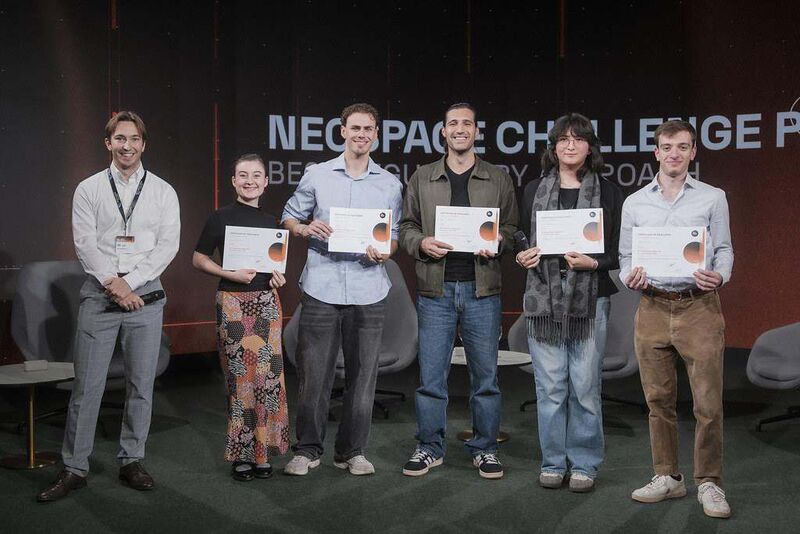

Small debris. Big challenge. Winning idea. 🛰️

I'm proud to share that our team, **Orbital Detector**, won the **regulatory category** at the **NeoSpace Challenge**!

Huge thanks to my teammates [Simone Giannini][simone], [Filipe Reis][filipe], [Ariane Marongiu][ariane], [Elise Lacourt][elise] and [Ricardo Santos][ricardo].

**The problem:** ground radars and telescopes track more than 50,000 objects larger than 10 cm. But about **1.2 million pieces of debris between 1 and 10 cm** are too small to track from Earth, yet still big enough to end a satellite mission.

**Our answer:** a 73 kg rideshare microsatellite in an 800 km dawn–dusk sun-synchronous orbit. It detects and characterises these small debris clouds where they are, in orbit. It carries a wide-angle survey camera, a gimballed narrow-field camera and an FMCW LiDAR, and sends its data products to external space situational awareness (SSA) catalogues.

**What we built together:**

- 🔧 **Satellite engineering and CONOPS:** we defined the mission objectives and the orbit, picked the payload and components, built the mass budget and wrote the concept of operations. That covers everything from survey mode through target confirmation to LiDAR ranging.
- ♻️ **End of life:** left alone at 800 km, the satellite would stay up for about 350 years. A Hohmann transfer down to 400 km (ΔV ≈ 161 m/s) brings it down within about 3 years. With electric propulsion, that only costs about 0.4 kg of extra propellant.
- 💼 **Business case:** debris monitoring is a market of about $1.2B, and mega-constellations keep raising demand. We would offer annual subscriptions to LEO operators and insurers for 1–10 cm debris data and collision alerts. The mission costs about €10M and would run for 10 years.
- ⚖️ **Regulatory framework:** licensing under Luxembourg's 2020 Space Activities Law, debris-mitigation rules and protection of our data. This is the work that won us the category.

Bringing engineering, business and law together in one team was what made the project work, and it showed how much space needs engineers and lawyers working side by side.

> "Seeing the debris we cannot track today is the first step to keeping LEO usable tomorrow."

Thanks to the organisers of the NeoSpace Challenge and to the **Master in Space Technologies and Business** for the chance to tackle a real space problem. 🚀

[simone]: https://www.linkedin.com/in/simone-giannini-973654336/
[filipe]: https://www.linkedin.com/in/filipe-reis-8b3916149/
[ariane]: https://minihic.info
[elise]: https://www.linkedin.com/in/elise-lacourt-576701294/
[ricardo]: https://www.linkedin.com/in/ricardo-santos-632b62246/
