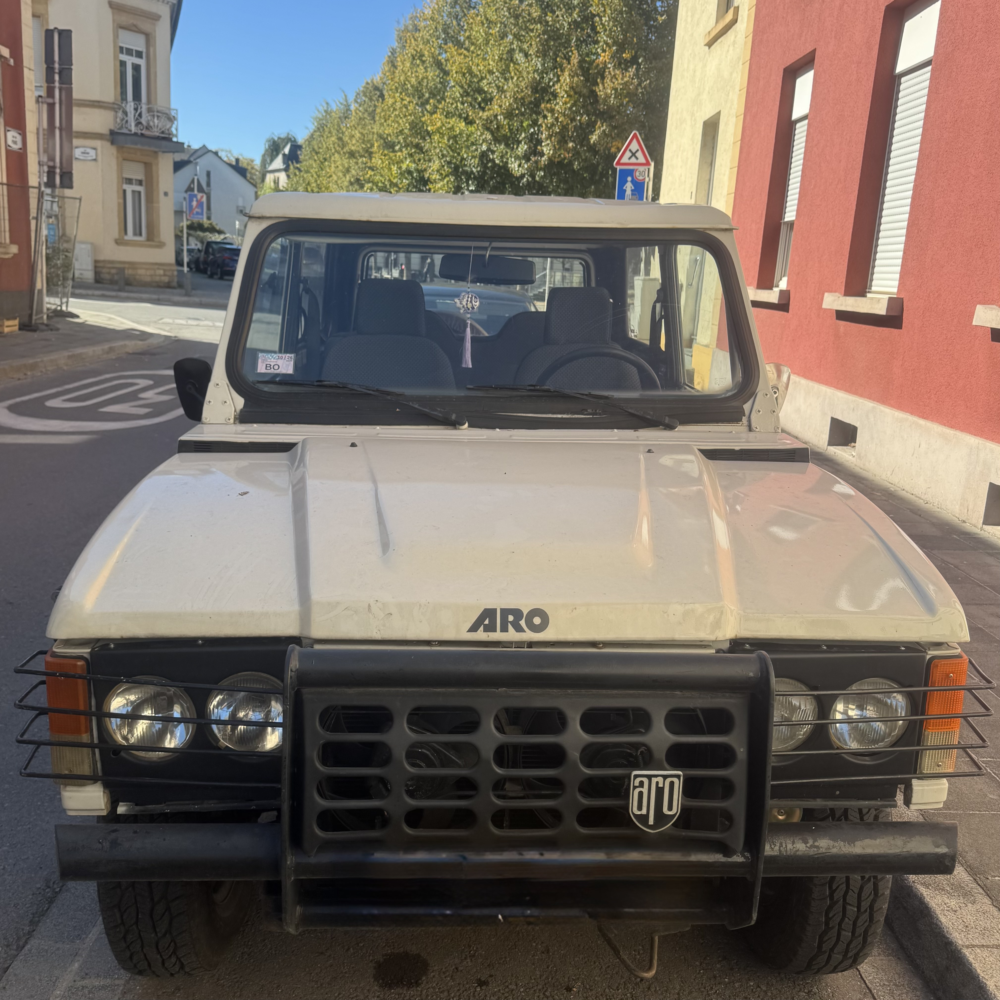

One of my dream cars is an ARO 10.4, a small off-roader build during communist times in Romania. My family comes from a town where these cars were build.

I had the chance to buy a model in pretty good driving conditions but it has been kept in a garage untouched for several years and I gave myself the challenge to bring this beauty to its glory years.

I imported the car from Romania to Luxembourg where I registered as a vintage car.

Before going into the details of the restauration, I would like to give you a bit of historical context of this special car.

The ARO 10.4 is the three-door hardtop of the ARO 10 series, a compact off-roader built in Câmpulung-Muscel, Romania, from 1980 to 2006. Designed as the smaller sibling of the ARO 24 and roughly the size of a Jeep Wrangler, it borrowed much of its mechanics from the Dacia 1300, which kept it simple and affordable to run. The ARO 10 was also exported widely, sold as the Dacia Duster in the UK and assembled in Italy under names like the ARO Ischia. My own 10.4 dates from 1996 and runs the naturally aspirated 1.9-litre Renault diesel, good for around 64 hp, a slow but sturdy engine well suited to the car’s no-nonsense character.
